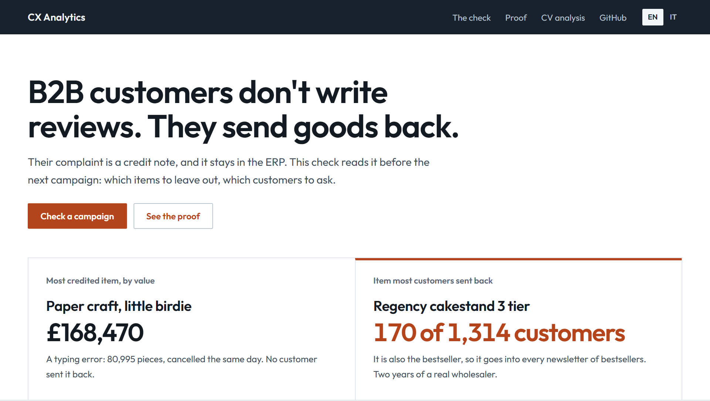

# E-commerce CX Analytics

**B2B customers don't write reviews. They send goods back.** This check reads credit notes as customer feedback: which items to leave out of the next campaign, and which customers to ask.

**[Open the page](https://errer441122.github.io/ecommerce-cx-analytics/)** · [the proof](reports/credit_notes.md) · [the analysis in my CV](#the-analysis-in-my-cv)

[](https://errer441122.github.io/ecommerce-cx-analytics/)

## The problem

The unhappy B2B customer asks for a credit note. It stays in the ERP, while the people who prepare the newsletter, the catalogue or the sales reps' list of bestsellers work somewhere else. So the item that customers are sending back gets pushed again.

Opening the ERP list is not enough. In two years of a real wholesaler, the most credited item by value is a typing error: 80,995 pieces, £168,470, cancelled the same day. The item that most customers really sent back is the **bestseller**: 170 of 1,314.

## How it works

One export with invoices and credit notes (customer, date, item, quantity), and the items you want to promote:

```bash
python src/credit_notes.py --lines lines.csv --campaign catalogue.csv
```

| File | What it is for |
| --- | --- |
| `campaign.csv` | Every item of the campaign: leave out, ok, or too few sales to say |
| `items_on_hold.csv` | The whole hold list, with the most frequent reason if the export has one: for quality, packaging, product pages |
| `customers.csv` | Who sent those items back, and who bought them in the last 30 days and has not complained yet, with the sales rep |

Three rules, no AI:

1. **A credit line is goods sent back only if the same customer bought the same item on an earlier day.** Same day is a typing correction. No earlier purchase is not counted.
2. **Customers are counted, not pieces.** One customer who returns 1,000 pieces is one problem.
3. **An item is on hold** when at least 3 customers sent it back in the last 60 days, at least 20 bought it, and the share is at least 3 times the one of all the other items. The thresholds are options.

It reads what ERPs write: semicolons, decimal commas, `31/12/2026`, SAP's trailing minus, Italian or English headers, and credit notes as negative quantities or as a document type (`TD04` in Italian e-invoicing). The same code runs [in the browser](https://errer441122.github.io/ecommerce-cx-analytics/#check), where the file never leaves the computer.

## The proof: nine checks on two years

Each check uses only what was known that day. Then only the purchases made *after* it count: how many customers sent the item back within 60 days.

| | Customers who bought after the check | Sent it back |
| --- | ---: | ---: |
| Items on hold | 20,516 | **6.9%** |
| All the other items | 444,858 | **1.5%** |
| Bestsellers on hold (19 of 180, about two in every list of 20) | 3,042 | **8.4%** |
| The other bestsellers | 18,487 | **1.5%** |

- **£406,764 of the £713,010 credited** was cancelled on the day it was invoiced. A list by value shows those first.
- **A customer who sends goods back is not leaving.** In 10 of 10 groups of similar customers, they ordered again at least as often. So the tool points at items, not at customers to save.

Every number is rebuilt by [`src/backtest.py`](src/backtest.py) in CI: [full tables](reports/credit_notes.md).

## What other software already does

| Tool | What it does | What stays open in B2B |
| --- | --- | --- |
| Email platform | Picks products: a Klaviyo [product feed](https://help.klaviyo.com/hc/en-us/articles/115005082787) filters by category, price, stock level and engagement | Returns are not among the filters |
| Reviews and surveys | Stars, comments, NPS | They reach whoever answers, often not the person who opened the box |
| Helpdesk | Sorts the complaints that become tickets | A credit note agreed by phone with the rep never becomes one |
| ERP | Lists credit notes by item, pieces or value | Typing errors on top, pieces instead of customers, and not where campaigns are prepared |

## What is real and what is not

| Real | Not yet |
| --- | --- |
| 805,828 invoice and cancellation lines of a UK company, many of whose customers are wholesalers (UCI, 2009 to 2011) | A company's own catalogue. Leaving the items out of a real campaign is the next step |
| The nine checks, made with what was known on each day | Why the goods came back: the public data has no reason column |

A cancellation dated after the purchase is read as goods sent back. That reading is mine; the dataset does not say why an invoice was cancelled.

## The analysis in my CV

| What my CV says | Where it is |
| --- | --- |
| About 95,000 real reviews (Olist): late delivery is the factor most tied to dissatisfaction, 27% of positive reviews against 83% for orders on time | [Full analysis](reports/cx_driver_analysis.md), "Delivery-SLA cohort": 95,639 reviews, 26.7% against 82.7% |
| Statistical tests, NPS proxy, logistic regression | In the same analysis. Olist has no NPS question: 5 stars count as promoters, 4 as passives, 3 or less as detractors. The finding is the comparison above; the regression checks it with state, category, delivery time and freight held constant |
| Brief for stakeholders | [Customer satisfaction brief](reports/customer_satisfaction_brief.md), by state and category |
| Python | [`src/`](src), and the [notebook](notebooks/cross_check.ipynb) that recalculates the main numbers with pandas and statsmodels |

Two tools stood here in November 2026, a list of late orders and a review triage. I removed them: shipping platforms and helpdesks already do both.

## Run it

```bash
python src/credit_notes.py --lines data/wholesale_demo.csv.gz
python -m unittest discover -s tests
```

Only Python is needed. The notebook has its own requirements.

| Path | Content |
| --- | --- |
| `src/credit_notes.py` | The three rules |
| `src/erp_export.py` | Reading ERP and Excel files |
| `src/backtest.py` | The nine checks |
| `src/cx_driver_analysis.py`, `src/build_cx_summary.py` | The analysis in my CV |
| `data/` | The wholesale lines and the reviews, with [sources and cleaning rules](data/REAL_DATA_PROVENANCE.md) |
| `docs/` | The page (GitHub Pages) |
| `tests/` | 29 checks, run on every change |

## Data

Chen, D. (2019), *Online Retail II*, UCI Machine Learning Repository, CC BY 4.0. Olist Brazilian E-Commerce, Kaggle, CC BY-NC-SA 4.0, used in a non-commercial portfolio.

## How I built this

I am a Digital Marketing student, not a developer. The code was written with AI coding assistants. My part was choosing the question, the rules and the data, checking the results and deciding what to report. MIT licence for the code.
